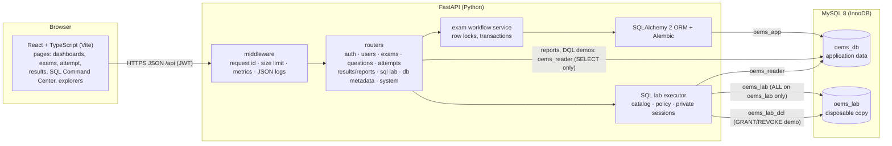
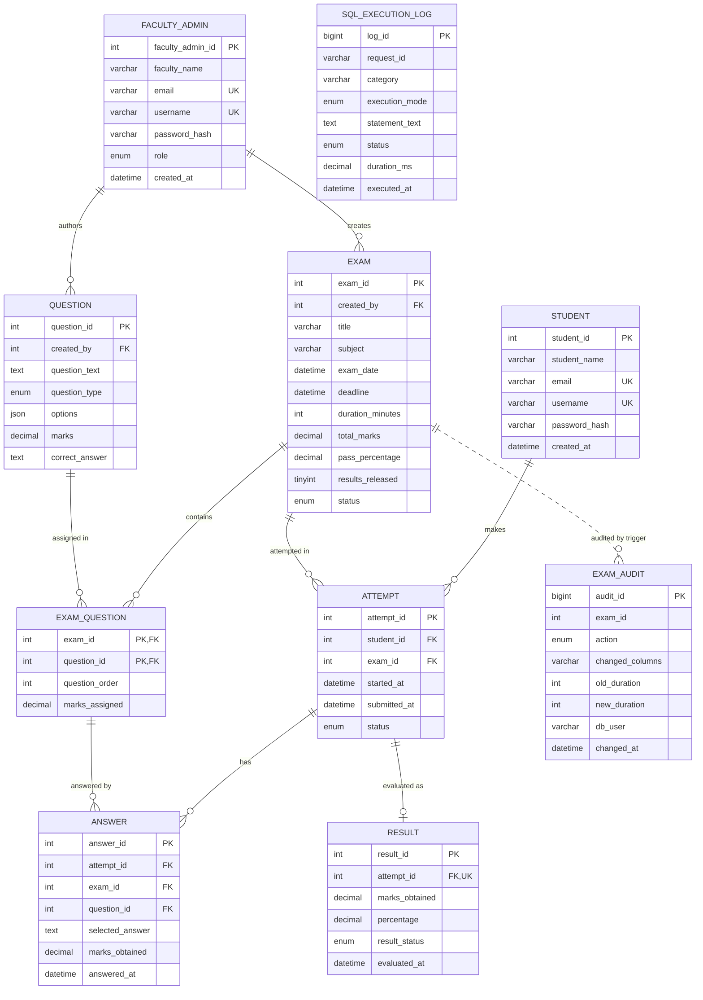
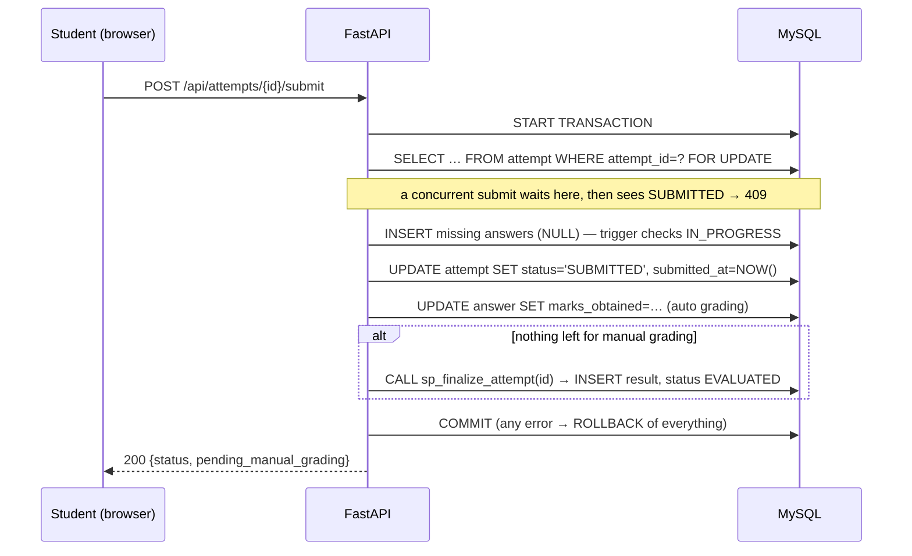

# OEMS — architecture and data model

## System architecture

The browser never talks to MySQL. Each server-side path uses the least-privileged
MySQL account that can do its job, so the database itself enforces the security
boundary:

| Account | Privileges | Used for |
|---|---|---|
| `oems_app` | SELECT, INSERT, UPDATE, DELETE, EXECUTE, SHOW VIEW, TRIGGER on `oems_db`; SHOW_ROUTINE | normal application work, metadata inspection |
| `oems_reader` | SELECT on `oems_db`; EXECUTE on 5 read-only routines | reports, DQL/join/subquery demos, table viewer, EXPLAIN |
| `oems_lab` | ALL on `oems_lab` only | DDL/DML/TCL/view/trigger/procedure/index demos, free-form SQL, lab reset |
| `oems_lab_dcl` | CREATE USER; ALL on `oems_lab` WITH GRANT OPTION | the predefined GRANT/REVOKE demonstration only |
| administrator (root) | everything | `scripts/init_db.py` and tests only — never the running API |

## Entity–relationship diagram

The Schema explorer page draws the same diagram live from `information_schema`.

### Additions to the DrawDB design (and why)

| Table | Column / rule | Reason |
|---|---|---|
| exam | `deadline`, `pass_percentage`, `results_released`, `created_at` | workflow requires deadlines, PASS/FAIL rule and result release |
| question | `created_by`, `options` (JSON), `created_at` | ownership; MCQ options must be stored somewhere |
| answer | `exam_id`, `answered_at` | `exam_id` lets two composite FKs prove the question belongs to the attempt's exam |
| attempt | `UNIQUE(student_id, exam_id)` | one attempt per student per exam ⇒ "submit exactly once" is a database guarantee |
| exam_question | `UNIQUE(exam_id, question_order)` | no two questions share a position |
| answer | `UNIQUE(attempt_id, question_id)` | one answer per question per attempt |
| faculty_admin | `created_at` | account audit trail |

## Integrity rules and where they live

| Rule | Enforced by |
|---|---|
| unique e-mail / username | `uq_student_email`, `uq_student_username`, … |
| no duplicate question in an exam | composite PK `pk_exam_question` |
| answer belongs to a valid attempt and to a question of that attempt's exam | `fk_answer_attempt_exam`, `fk_answer_exam_question` |
| valid durations / marks / percentages / exam window | CHECK constraints (`chk_exam_duration`, `chk_exam_window_fits`, `chk_result_percentage`, …) |
| one result per attempt | `uq_result_attempt` |
| no duplicate / concurrent submission | `uq_attempt_student_exam` + `SELECT … FOR UPDATE` in one transaction |
| answers locked after submission; marks ≤ question marks | triggers `trg_answer_before_insert/update` (SIGNAL 45000) |
| total marks always equal to assigned marks | triggers on `exam_question` |
| audit of exam changes | triggers `trg_exam_after_insert/update/delete` |
| result creation only for fully graded, submitted attempts | procedure `sp_finalize_attempt` |

## Submission transaction

